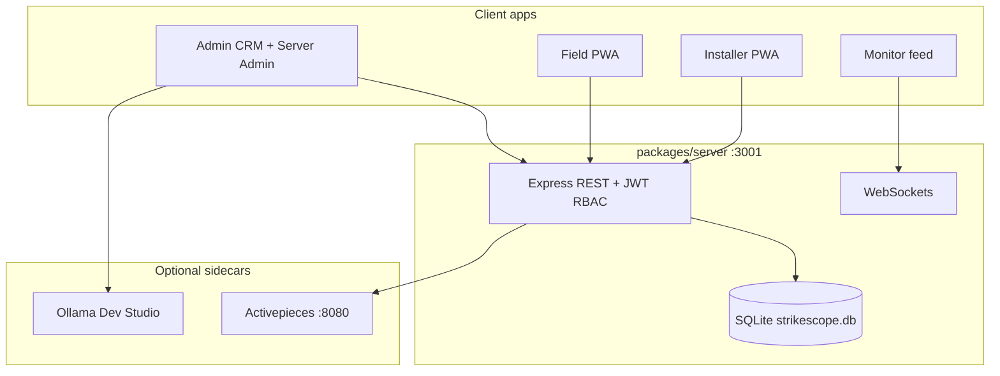

# StrikeScope

**Self-hosted multi-tenant CRM with enterprise IAM — RBAC, field-level PII, MFA, audit trail, and AI-assisted platform engineering.**

[](LICENSE)
[](https://nodejs.org/)
[](https://www.typescriptlang.org/)
[](docs/SECURITY-IAM.md)

**Author:** [Joseph Edwards (@GatoGodMode)](https://github.com/GatoGodMode)

StrikeScope is a **self-maintainable, self-hosted** business platform: one Express server, SQLite tenancy, multiple client apps, optional Activepieces orchestration, and a Dev Studio AI that observes schema and code structure. Built to demonstrate **IAM depth** (entity + column-level permissions, MFA, audit) and a credible path toward **local AI SIEM/SOAR** — documented honestly as [roadmap, not shipped](docs/ROADMAP-SENTINEL.md).

---

## Why this exists (IAM / platform engineering)

| Shipped today | Evidence |
|---------------|----------|
| **Entity RBAC** | CRUD matrix per role across leads, customers, users, audit, … |
| **Field-level PII** | Independent view/edit on `ssn_last_four`, `date_of_birth`, co-signer fields |
| **MFA (TOTP)** | Optional second factor on login |
| **Multi-tenant isolation** | Companies, memberships, domain routing, workspace tests |
| **Audit trail** | `activities` table + gated audit permissions |
| **Automation keys** | Scoped `ssap_*` service keys for orchestration |
| **App hardening** | Helmet, rate limits, prod JWT secret enforcement |
| **AI schema observer** | Dev Studio RAG + SQL console over platform knowledge |
| **Orchestration layer** | Activepieces events + custom StrikeScope piece |

**In progress:** [Sentinel](docs/ROADMAP-SENTINEL.md) — local AI SIEM/SOAR with company-maintained playbooks.

Full IAM model: **[docs/SECURITY-IAM.md](docs/SECURITY-IAM.md)**

---

## Architecture



Monorepo layout: `packages/admin` · `packages/server` · `packages/field` · `packages/installer` · `packages/monitor` · `shared` · `EnVars/`

Details: [docs/ARCHITECTURE.md](docs/ARCHITECTURE.md)

---

## IAM at a glance

### Entity permissions (example: Project Admin role)

| Entity | View | Create | Edit | Delete |
|--------|:----:|:------:|:----:|:------:|
| Leads | ✓ | | | |
| Customers, Projects, Contacts | ✓ | ✓ | ✓ | ✓ |
| Submissions | ✓ | | | |
| Settings, Users | | | | |
| Audit | ✓ | | | |

### Field-level PII (all roles configurable)

| Entity | Field | Purpose |
|--------|-------|---------|
| Contacts | `ssn_last_four` | SSN last four — credit/identity |
| Contacts | `date_of_birth` | DOB verification |
| Leads | `co_signer_*` | Co-signer contact info |

Configured in **Admin → Roles & Permissions**; enforced in [`packages/server/src/auth.ts`](packages/server/src/auth.ts) and [`field-permissions.ts`](packages/server/src/field-permissions.ts).

---

## Platform features

- **Server Admin** — companies, users, domains, project types, Dev Studio
- **CRM** — leads pipeline, customers, contacts, agreements, projects, forms builder
- **Field ops** — geofenced clock-in, photo submissions, foreman workflows
- **Finance** — commission formulas, payout evaluation
- **Territory / geo** — jurisdiction tracking, maps integration
- **Automations** — Activepieces embed + CRM event emitter
- **Dev Studio** — local AI agent: migrations, code patches, ship/rollback (dev mode)
- **Distribution** — Windows launcher, `npm run dev`, production build serves admin from server

---

## Quick start

**Requirements:** Node.js 20+, npm 9+

```bash
git clone https://github.com/GatoGodMode/StrikeScope.git
cd StrikeScope
npm install
cp .env.example .env
npm run seed    # optional legacy installer seed
npm run dev     # server + all Vite apps
```

Or on Windows: `Launcher.bat` / `npm run launcher`

**Dev login (local only):**

| Email | Password | Role |
|-------|----------|------|
| `admin@strikescope.local` | `admin` | `server_admin` |

Change immediately outside localhost. See [SECURITY.md](SECURITY.md).

**URLs (dev):**

| App | URL |
|-----|-----|
| Server + Admin (prod build) | http://localhost:3001 |
| Admin (Vite dev) | http://localhost:5173 |
| Server Admin dashboard | http://localhost:3001/server/dashboard |

---

## Sentinel roadmap (not shipped)

StrikeScope is evolving toward a **local AI security sentinel**:

1. Structured security events from audit + auth + automations
2. Company-authored response playbooks
3. Correlation without third-party cloud SIEM
4. Ollama-assisted incident summaries

See **[docs/ROADMAP-SENTINEL.md](docs/ROADMAP-SENTINEL.md)** — no fake SIEM UI in this repo.

---

## Development

```bash
npm run lint
npm run typecheck
npm run build
npm run test
```

CI: [`.github/workflows/ci.yml`](.github/workflows/ci.yml)

Optional automations sidecar:

```bash
npm run automations:up
```

---

## Documentation

| Doc | Contents |
|-----|----------|
| [docs/ARCHITECTURE.md](docs/ARCHITECTURE.md) | Apps, tables, API map |
| [docs/SECURITY-IAM.md](docs/SECURITY-IAM.md) | RBAC, MFA, PII, audit, threat model |
| [docs/ROADMAP-SENTINEL.md](docs/ROADMAP-SENTINEL.md) | SIEM/SOAR vision (WIP) |
| [SECURITY.md](SECURITY.md) | Vulnerability reporting, prod checklist |
| [CHANGELOG.md](CHANGELOG.md) | Version history |

---

## License

MIT — see [LICENSE](LICENSE).

**Related:** [GatoGodMode profile](https://github.com/GatoGodMode) · [OrphanHunter](https://github.com/GatoGodMode/OrphanHunter) · [CollectorBuyerPsych](https://github.com/GatoGodMode/CollectorBuyerPsych)
